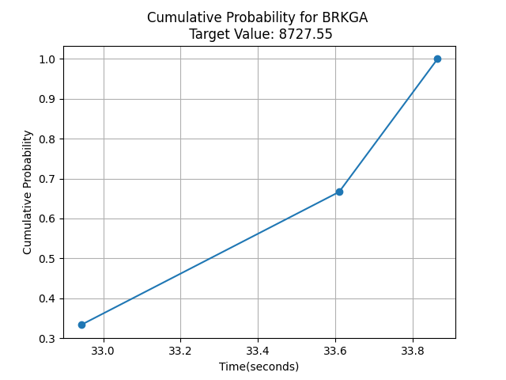
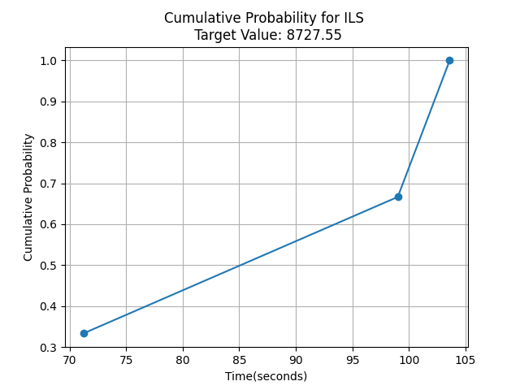
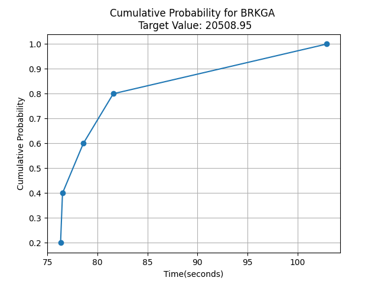
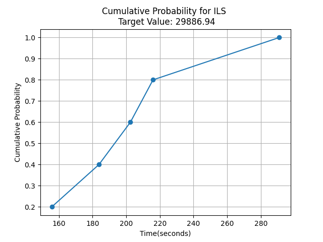

# Introdução
Esse trabalho tem como objetivo apresentar uma implementação do problema do caixeiro viajante com coleta e entrega, utilizando as técnicas de Iterated Local Search e Biased Random-Key Genetic Algorithm. O problema do caixeiro viajante é um clássico da otimização combinatória, onde o objetivo é encontrar a rota mais curta que visita um conjunto de cidades e retorna à cidade de origem. No entanto, a variante com coleta e entrega adiciona uma camada adicional de complexidade, pois envolve a necessidade de coletar itens em determinados locais e entregá-los em outros locais específicos.
  
# Problema do Caixeiro Viajante com Coleta e Entrega
O problema do caixeiro viajante com coleta e entrega pode ser formalmente definido da seguinte maneira: dado um conjunto de cidades, cada uma com uma demanda de coleta ou entrega, o objetivo é encontrar a rota mais curta que visita todas as cidades, satisfazendo as demandas de coleta e entrega. A principal restrição é a necessidade de coletar itens antes de entregá-los na cidade de destino.
  
## Implementação do Problema
Para implementar o problema do caixeiro viajante foi necessário modelar as classes "City" e a "TravelingSalesmanPickupAndDelivery". A classe "City" representa uma cidade com um identificador da matriz de adjacência, coordenadas x e y, representa se é um ponto de coleta ou entrega e a demanda associada, essa classe contém o metódo "calculateDistance" que calcula a distância euclidiana desse cidade com outra cidade. Já a classe "TravelingSalesmanPickupAndDelivery" representa o problema em si, contendo a matriz de distâncias entre as cidades, o número total de cidades e uma lista de pares de coleta e entrega. O método "evaluate" calcula o custo total da rota, levando em consideração as distâncias entre as cidades e as demandas de coleta e entrega.
  
# Iterated Local Search(ILS)
O Iterated Local Search é uma das duas meta-heurísticas utilizadas neste projeto para o problema do caixeiro viajante com coleta e entrega. Ele funciona em um ciclo bem simples para evitar ficar preso em soluções ótimas locais por meio da "perturbação".
  
## Conceitos para entender a ILS
Para compreender o algoritmo, é preciso entender os conceitos principais utilizados.
  
### Solução
Uma solução é, simplesmente, uma combinação que resolve o problema em acordo com suas regras. No caso deste Caixeiro Viajante, seria uma solução qualquer caminho que respeitasse às restrições de coleta e entrega.
### Solução ótima global
A solução ótima global é a solução que **melhor** resolve o problema. Neste caso, seria o menor caminho possível, dentro de **todas** as possíveis soluções.
### Solução ótima local
Já a solução ótima local é uma solução que é a melhor *dentre soluções similares a ela*, mas que não necessariamente é a melhor de todas. Por exemplo: seria uma solução ótima local um caminho tal que não se pudesse diminuir seu tamanho sem grandes alterações nele.
### Perturbação
Enquanto os últimos três conceitos são amplamente utilizados no contexto de problemas de otimização, a perturbação é algo particular do ILS. Ela é um operador de transição que faz mudanças mais drásticas a uma solução, de modo a resultar em uma solução que está fora do "local" da prévia. Dessa maneira, a nova solução consegue chegar em soluções diferentes da última ótima local encontrada.
  
## O fluxo da ILS
Tendo isso em vista, é possível explicar o funcionamento da busca, o qual é baseado em um simples fluxo caracterizado por:
Solução inicial -> Solução ótima local -> Perturbação -> Outra ótima local -> Comparação de melhor até agora -> Perturbação -> Outra ótima local -> Perturbação ->...
e por aí vai, até que se dê o critério de término.
  
Explicando melhor, ocorrem buscas com alterações simples de melhoria para achar soluções ótimas locais, que, quando são encontradas, são mudadas mais fortemente pela perturbação, para que se encontre outras soluções ótimas locais. Assim, o algoritmo pode ir sempre tentando chegar mais próximo da solução ótima global ao não se prender a um ótimo local.
  
# Biased Random-Key Genetic Algorithm(BRKGA)
O Biased Random-Key Genetic Algorithm (BRKGA) é a segunda meta-heurística usada no projeto. Ela é uma variante avançada dos algoritmos genéticos. Baseado no RKGA (Random-Key Genetic Algorithm), o algoritmo introduz um viés (bias) para o processo de reprodução.
  
## Algoritmos Genéticos(AG)
Algoritmos genéticos são aqueles que funcionam por meio do princípio da evolução de Darwin, tratando cada solução possível como um indivíduo de uma população. A qualidade de cada indivíduo é avaliada por uma função objetivo.
  
Nesse processo, os melhores indivíduos são selecionados como pais para o cruzamento, combinando suas características para dar origem a uma nova geração que passará pelo mesmo ciclo evolutivo. Em um AG tradicional, além do cruzamento, ocorrem operações de mutação (alterações pontuais nos indivíduos) para garantir a diversidade genética da população e evitar que o algoritmo fique estagnado em sub-ótimos locais.
  
## Random-Key Genetic Algorithm(RKGA)
O RKGA simplifica o processo evolutivo ao utilizar "chaves aleatórias", vetores de números reais entre 0 e 1, em vez de representar as soluções diretamente com os valores ou variáveis reais do problema (como rotas, tarefas ou horários específicos). Para avaliar se um indivíduo é bom, o algoritmo usa um "decodificador" independente, que é uma função responsável por traduzir as chaves aléatórias em uma solução prática e válida. A grande vantagem disso é que a lógica de busca do algoritmo fica totalmente separada do problema real, permitindo reaproveitar o mesmo código para problemas diferentes apenas trocando o decodificador.
## Viés do BRKGA
O grande diferencial do BRKGA está no viés introduzido durante o cruzamento, onde o algoritmo garante que pelo menos um dos pais selecionados pertença sempre à elite da população. Além disso, no momento de gerar o descendente, há uma probabilidade significativamente maior (geralmente em torno de 70%) de o filho herdar cada gene desse pai de elite, o que acelera drasticamente a convergência do algoritmo em direção a soluções de alta qualidade.
  
Para manter a diversidade genética e evitar que a população fique presa em soluções intermediárias pela forte influência da elite, o BRKGA introduz indivíduos mutantes ao inves da mutação tradicional. Esses novos indivíduos são gerados de forma totalmente aleatória e inseridos a cada nova geração, injetando novos genes aleatórios no processo e permitindo que o algoritmo continue explorando novas possibilidades de solução.
  
# Resultados
  
## Grafíco Time-to-Target(TTT)
O grafíco Time-to-Target(TTT) é uma representação grafíca que mostra a probalidade de uma heuristica alcançar um valor igual ou melhor que um valor objetivo em um determinado tempo ou numero de iterações. é gerado uma instancia da heuristica e é executada várias vezes, armazenando o valor da melhor solução encontrada e o "custo"(tempo ou numero de iterações) para alcançar essa solução. O grafíco é gerado plotando o custo no eixo x e a probabilidade acumulada no eixo y, mostrando a eficiência da heuristica em alcançar soluções de alta qualidade ao decorrer do custo.
  
  
## Resultados dos testes
 As heuristicas foram testadas com 5 execuções do algoritmo para cada problema do caixeiro viajante com coleta e entrega, e o valor objetivo foi determinado a partir do melhor valor conhecido multiplicado por 1.45. Foi feito o ajuste no valor objetivo, pois as meta-heurísticas não estavam se provando capazes de chegar no melhor global real(não em tempo razoável, pelo menos).
 Para a instância 1, em específico, o critério de parada das meta-heurísticas era baseado na quantidade de iterações. Por isso, há resultado que não chegou no target, mesmo tendo capacidade para tal, apenas por uma limitação imposta.
  
 Para rodar os testes o BRKGA foi configurado para rodar por 200 gerações, enquanto a ILS foi configurada para rodar por 1200 iterações. 
  
 Caso nenhuma das 5 execuções de cada heurística tenha alcançado o valor objetivo, o gráfico TTT foi gerado com o maior valor encontrado como o valor objetivo, para que se possa comparar as duas heurísticas mesmo sem chegar no alvo proposto.
  
### Instância 1 (pdtsp-105)
A instância pdtsp-105 é a menor dentre as instâncias testadas, contendo apenas 105 cidades, o resultado do **BRKGA** obtido por meio do grafico time-to-target, com um valor objetivo de 8727.5 foi:

O gráfico mostra que o BRKGA com 500 gerações tem 3 das 5 execuções que alcançaram o valor objetivo, com um tempo máximo de 34 segundos para alcançar esse valor.
  
Já para a **ILS**:
  

O gráfico mostra que, também o ILS teve três execuções que chegaram, dentro do limite de iterações, no alvo, mas de maneira muito mais demorada.
  
  
### instâncias seguintes
### instância 2 (pdtsp-171)
A instância pdtsp-171 contém 171 cidades, e o resultado obtido foi de que nenhuma instancia alcançou o valor objetivo para o caso do BRKGA, isso é mostrado a partir do valor objetivo de seu grafico time-to-target:

  
O valor alto de 20508 não condiz com o primeiro valor objetivo proposto de 14794, o que demonstra que o BRKGA com 200 gerações não é capaz de alcançar o valor objetivo nessa instância, o que pode ser atribuído ao aumento da complexidade do problema devido ao maior número de cidades.
  
Já para a **ILS**
  

O gráfico mostra que o ILS com 1200 iterações tem 0 das 5 execuções que alcançaram o valor objetivo, isso demonstra que o paramêtro de 1200 iterações para o terminio do algoritmo não é suficiente para alcançar o valor objetivo nessa instância, o que pode ser atribuído ao aumento da complexidade do problema devido ao maior número de cidades.
  
  
### instância 3 (pdtsp-213)
A instância pdtsp-213 contém 213 cidades, e o resultado obtido por meio do grafico time-to-target, foi que nenhuma instancia alcançou o valor objetivo no caso do BRKGA, isso é mostrado a partir do valor alto de 26325 não condiz com o primeiro valor objetivo proposto de 19688.5, o que demonstra que o BRKGA com 200 gerações não é capaz de alcançar o valor objetivo nessa instância, o que pode ser atribuído ao aumento da complexidade do problema devido ao maior número de cidades.
Já para a **ILS**
O gráfico mostrou que o ILS com 1200 iterações também não conseguiu alcançar o valor objetivo, com um valor alto de 24431.41, o que demonstra que o paramêtro de 1200 iterações para o terminio do algoritmo não é suficiente para alcançar o valor objetivo nessa instância, o que pode ser atribuído ao aumento da complexidade do problema devido ao maior número de cidades.
  
### Instância 4
A instância pdtsp-318 contém 318 cidades, e o resultado obtido por meio do grafico time-to-target, foi que nenhuma instancia alcançou o valor objetivo no caso do BRKGA, isso é mostrado a partir do valor alto de 34864 não condiz com o primeiro valor objetivo proposto de 24862.5, o que demonstra que o BRKGA com 200 gerações não é capaz de alcançar o valor objetivo nessa instância, o que pode ser atribuído ao aumento da complexidade do problema devido ao maior número de cidades.
  
já para a **ILS**
  
O gráfico mostrou que o ILS com 1200 iterações também não conseguiu alcançar o valor objetivo, com um valor alto de 34425.5, o que demonstra que o paramêtro de 1200 iterações para o terminio do algoritmo não é suficiente para alcançar o valor objetivo nessa instância, o que pode ser atribuído ao aumento da complexidade do problema devido ao maior número de cidades.
  
### Outra abordagem para os testes
Em seguida, tentou-se um novo critério de término: a chegada no target(alvo), por meio da classe GotToTarget, que herda de Termination. Essa mudança serviria para garantir a chegada ao target pelos algoritmos, com o alvo novamente sendo o melhor x 1,45. Ainda assim, verificaram-se problemas relacionados ou a tempo de execução absurdo ou a prisão em soluções ótimas locais, de modo que algumas das execuções realizadas mantiveram limite de iteração, com o gráfico sendo plotado com target value como o melhor(no caso, menor) custo encontrado, para, pelo menos, poder-se fazer uma comparação entre as duas heurísticas.
  
Não foram colocados todas as imagens de gráficos em razão do limite de páginas previsto para este documento.
  
  
  
# Conclusão 
Em primeira instância, pode-se afirmar que, nas condições em que as meta-heurísticas foram implementadas, o BRKGA foi mais eficiente. Isso mostra a importância da escolha da heurística utilizada para a resolução de problemas de otimização, tendo em vista que umas podem se sair melhores que outras. Contudo, os resultados dos experimentos não nos permitem concluir a superioridade inerente do BRKGA sobre o ILS, uma vez ambos se mostraram limitados nos testes, isto é, ambos falharam em chegar nas soluções mais próximas da ótima global em instâncias grandes. 

Essa falha nos permite afirmar, então, em última instância, que, não só é importante a escolha da heurística, mas também dos parâmetros que ela recebe e das funções auxiliares utilizadas. No caso da ILS, por exemplo, por conta da baixa otimização dos algoritmos de busca local e da necessidade de perturbação para sair de ótimas locais, formou-se um dilema entre deixar uma perturbação forte mas igualmente aleatória e deixar uma perturbação mais fraca, que mantivesse melhor as qualidades do ótimo local, mas que tivesse o perigo de ficar presa nele. E ambos os casos podem acabar sendo péssimos para as instâncias grandes do problema analisado: a perturbação fraca pode ficar presa a uma única solução ótima local, enquanto que a perturbação forte retarda bastante o algoritmo ao alterar drasticamente soluções que já eram consideradas boas, fazendo o processo todo ter um custo de tempo não razoável.
  